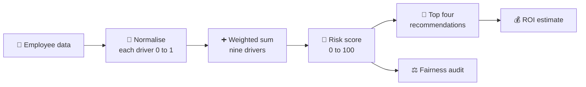

# 🧠 Retention Intelligence

## 🎯 The problem

Most flight-risk tools hand HR a number and nothing else. Nobody can say why someone scored 82, so managers distrust it and employees can't challenge it. Opaque models can also hide pay and demographic gaps.

**This project shows the alternative:** a score that explains itself, answers what-if questions, puts a price on inaction and audits itself for fairness.

---

## ⚔️ Black-box tools vs this project

| | ❌ Typical black-box tool | ✅ Retention Intelligence |
|---|---|---|
| 🔍 **Explainability** | One score, no reasoning | Contribution bar for each of nine drivers |
| 🎚️ **What-if** | Rerun the model and wait | Seven live sliders, instant update |
| 🧭 **Next step** | "High risk, good luck" | Top four prioritised actions |
| 💰 **Business case** | Not included | Replacement cost, expected cost, payback ratio |
| ⚖️ **Fairness** | An afterthought | Built-in audit by gender and age band |
| 🔐 **Privacy** | Often uploaded to a vendor | Everything stays in your browser |

---

## ✨ Features

### 🔍 Understand the score
- **Explainable scores:** a 0 to 100 risk score per employee, with a bar showing how many points each driver adds.
- **Risk bands:** 🟢 Stable (below 40), 🟡 Watch (40 to 69), 🔴 High risk (70 and above).

### 🎚️ Test interventions
- **What-if sliders:** salary, work-life balance, manager relationship, engagement, recognition, months since promotion and overtime. The score recalculates live.
- **Apply recommended actions:** one click shows a before and after score.
- **Recommendation engine:** the top four rule-based retention actions for each person.

### 💰 Make the business case
- **Retention ROI:** replacement cost (1.4x salary), risk-weighted cost, intervention cost and payback ratio.
- **Executive KPIs:** headcount, high-risk count, expected attrition cost and protectable cost.

### ⚖️ Audit and explore
- **Fairness audit:** compares average risk and pay gap by gender and age band, and flags disparities.
- **Department view:** average risk and high-risk headcount per department. Click one to filter.
- **Roster:** searchable, sortable and keyboard accessible, with a 30-second guided tour.

---

## 🧮 How the score works

A transparent weighted sum. Each of nine drivers is scaled from 0 to 1, multiplied by its weight and added up to a score out of 100.

| # | Driver | Weight | Share |
|:-:|---|---:|---|
| 1 | 💵 Below-market pay | 20% | ████████████████████ |
| 2 | ⚖️ Work-life balance | 15% | ███████████████ |
| 3 | 🤝 Manager relationship | 15% | ███████████████ |
| 4 | 🔥 Engagement | 15% | ███████████████ |
| 5 | 📈 Time since promotion | 12% | ████████████ |
| 6 | 👏 Recognition | 10% | ██████████ |
| 7 | ⏱️ Overtime load | 8% | ████████ |
| 8 | 👥 Team-level attrition | 8% | ████████ |
| 9 | 🌱 Onboarding stage | 7% | ███████ |

> [!NOTE]
> A small random residual (between -6 and +6 points) stands in for everything the model cannot see.

---

## ⚡ Try it in 60 seconds

1. 🔴 Click **Show me the highest-risk employee**.
2. 🔍 Read the factor bars to see what drives the score.
3. 🎚️ Drag the **Salary** slider and watch the score and cost change.
4. ✅ Click **Apply recommended actions** for the before and after.
5. ⚖️ Scroll to the **Fairness audit** and look at the pay gap flag.

---

## 💻 Run locally

1. Download `jhanavi.html` from this repo (open it, then click the download icon).
2. Double-click the file to open it in any browser. No install needed.

Or serve it with `python -m http.server 8000` and visit `http://localhost:8000`.

---

## 🛡️ Honest limitations

> [!IMPORTANT]
> This is a design demonstration, not a production model.

- 🧪 **All data is synthetic.** No real company or person is represented.
- 📐 **The model is rule-based and illustrative.** It is not trained on real data, so scores are not predictions.
- 🗣️ **A score should start a conversation.** It should never replace human judgment.
- ⚖️ **A pay gap is built in on purpose** (female salaries x 0.965) so the fairness audit has something real to detect.

---

## 🚀 What I would build next

- [ ] Train on real HRIS data with logistic regression or gradient boosting, explained with **SHAP values**
- [ ] Add **survival analysis** to estimate when someone might leave
- [ ] Add **intersectional fairness metrics** and the four-fifths rule
- [ ] Add PDF and CSV **report export**

---

## 🧰 Skills demonstrated

`People Analytics` `HR Metrics` `Explainable AI` `Fairness Auditing` `Data Storytelling` `JavaScript` `UX`

---

## 👩‍💼 About the author

**M.S. Jhanavi** · MBA (HR), KL Business School

I build people-analytics projects that show the reasoning behind the numbers. Let's connect.

- 💼 **LinkedIn:** linkedin.com/in/jhanavi-ms-81591233a
- 📧 **Email:** jhanavimba.hr@gmail.com

⭐ If you found this useful, a star on the repo is appreciated.
